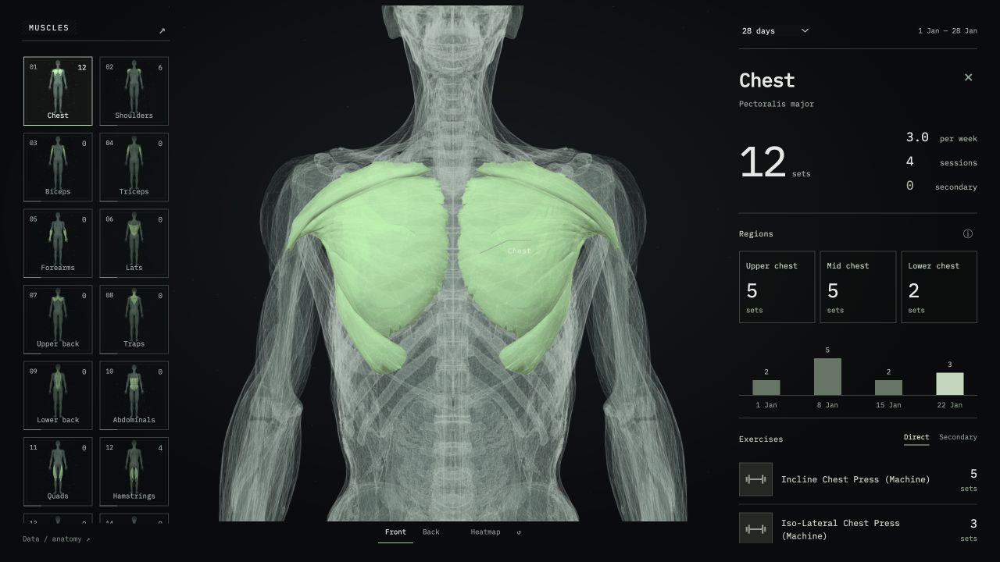
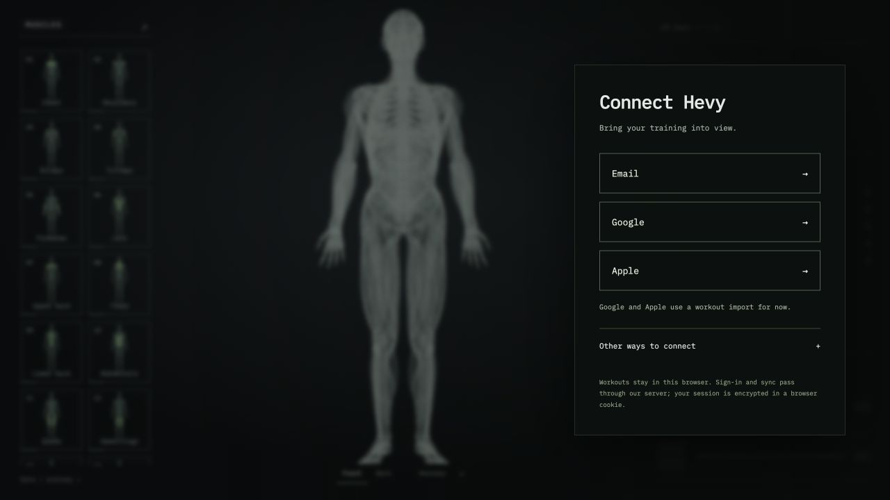

# Hevy Muscle Atlas

Explore your training on an interactive 3D anatomy model. Select a muscle to see its direct sets, supporting work, weekly distribution, and the exercises behind those numbers.

[Live dashboard](https://hevy-muscle-atlas.vercel.app/)



## What it does

- Click muscles on the model to highlight them and focus the camera. Rotate the figure, switch front/back, or explore the heatmap.
- See direct sets separately from secondary work and drop sets. Warm-ups and empty sets are excluded.
- Explore upper, mid, and lower chest emphasis; front, side, and rear shoulder emphasis; and the broader anatomy of other muscle groups.
- Expand an exercise to inspect its logged sets. Compare 7-day, 28-day, 90-day, or full-history windows.
- Use the same interface on desktop and mobile. Data is cached in the current browser.

Regional counts describe **exercise emphasis**, not isolated activation or measured growth. Subregions that cannot be separated from the exercise log show their parent muscle group's totals. The figure is an anatomical reference, not a scan of your body. Periods end on the latest loaded workout.

## Connection status

| Method | Status |
| --- | --- |
| Hevy CSV or dashboard JSON | Available; no Pro API key needed |
| Hevy public API key | Available; Hevy currently requires Pro for a key |
| Hevy email/password | Experimental Vercel implementation; invalid-credential handling verified, successful real-account sync still unverified |
| Google / Apple | Direct sign-in is not implemented. These choices lead to workout import. |
| Hevy in ChatGPT | Manual JSON export and import; not a live MCP connection |

The live deployment may lag behind the source. It currently supports imports and API keys; the new sign-in interface is being tested in a preview.

The source includes a three-option connection screen. Selecting Email transforms the same three rows into email, password, and confirm, with reduced-motion support. Google and Apple remain clearly identified as import routes until the app has an authorized integration.



## Try it locally

Requires Python 3 to serve the frontend and Node.js 22.12+ to run tests.

```sh
git clone https://github.com/RahulDobhal/hevy-muscle-atlas.git
cd hevy-muscle-atlas
npm start
```

Open http://127.0.0.1:4173. Under **Other ways to connect → Import workouts**, select [`examples/demo-workouts.json`](examples/demo-workouts.json) to explore the interface without sharing any personal data. Every workout in that file is synthetic.

The static local server supports imports and direct API-key sync. Hosted email/password sign-in needs the Vercel function.

```sh
npm test
```

All tests use synthetic fixtures or mocked requests. No Hevy credentials or private workout files are needed.

## Deploy to Vercel

Import the repository, choose **Other** as the framework, and set the project's **Root Directory to `dist`**. The included `vercel.json` supplies the output directory, security headers, and server-function configuration. Alternatively, run the Vercel CLI from `dist/`.

For the experimental email/password route, configure:

| Variable | Value |
| --- | --- |
| `PUBLIC_ORIGIN` | Your production origin, such as `https://your-project.vercel.app`, without a trailing slash |
| `HEVY_SESSION_SECRET` | A base64-encoded, cryptographically random 32-byte key, stored as a sensitive Vercel environment variable |

Generate a key locally:

```sh
node -e "console.log(require('node:crypto').randomBytes(32).toString('base64'))"
```

Configure preview and production environments separately. Never commit a generated secret. Rotating it invalidates existing sessions. See [`dist/.env.example`](dist/.env.example) for the variable names.

The backend uses Vercel Node functions, Puppeteer, and Chromium during sign-in. It requires no database or separately managed server. Hosting remains subject to your Vercel plan's limits; this is not a promise of unlimited free hosting.

## Data and privacy

- Workouts are stored in IndexedDB on the current browser/origin. There is no app account database or cross-device cache.
- API-key mode connects directly from the browser to Hevy; its key stays in browser storage.
- Experimental password mode sends credentials to this app's Vercel function, which uses Hevy's ordinary login page. Passwords and workout bodies are not saved or logged by the app.
- Access and refresh tokens are encrypted with AES-256-GCM in a Secure, HttpOnly, SameSite=Strict browser cookie. Only the server holds the encryption key. Cookies last up to 30 days and rotate on refresh.
- Server sync is bound to the account verified at login. Client-supplied account names and arbitrary upstream URLs are not accepted. Requests require same-origin JSON POSTs. Sign-in throttling is best-effort per server instance, not distributed.
- Sync replaces the cache only after the complete history has loaded. A failed sync preserves the previous workouts. Sync is manual.
- Disconnect clears the session and browser cache. JSON exports contain workouts and exercise templates, never credentials.

This is an independent project, not an official Hevy integration. The web-login route is experimental, depends on Hevy's website, and does not support interactive verification or Google/Apple authentication. It is separate from the official Hevy connector available in ChatGPT.

## Code map

- `dist/app.js` — Three.js anatomy, selection, and dashboard rendering.
- `dist/data-engine.js`, `dist/regions.js` — set aggregation and exercise-emphasis mapping.
- `dist/connection.js`, `dist/auth-picker.js` — browser storage and connection UI.
- `dist/hevy-client.js` — public API-key client.
- `dist/api/hevy.js`, `dist/session-client.js` — experimental hosted sign-in and sync.
- `tests/` — aggregation, parsing, mapping, pagination, session integrity, origin validation, and account-bound refresh tests.

The frontend is plain HTML, CSS, and JavaScript with vendored Three.js. There is no frontend build step.

## Third-party credits

The bundled anatomy model is **Écorché by Charleeh**, licensed under **CC BY-SA 4.0**, derived from BodyParts3D and Z-Anatomy. Its geometry is unchanged here; rendering materials and training associations are customized. Keep the [full attribution](dist/assets/ATTRIBUTION.md) and [model license](dist/assets/CC-BY-SA-4.0.txt) with the asset.

Three.js and meshoptimizer retain their [MIT notices](dist/vendor/THREE-LICENSE.txt) and [meshoptimizer license](dist/vendor/MESHOPTIMIZER-LICENSE.txt). IBM Plex Mono loads from Google Fonts. Hevy exercise images are fetched from template URLs; cached images and private workout exports are excluded from the repository.
